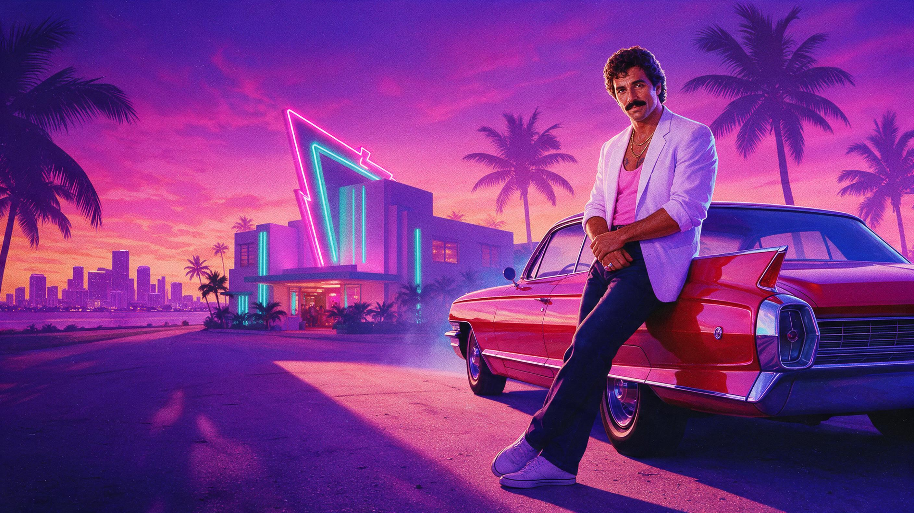
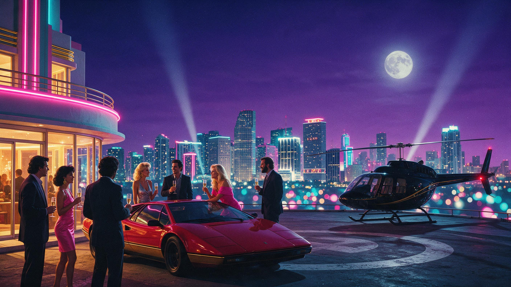
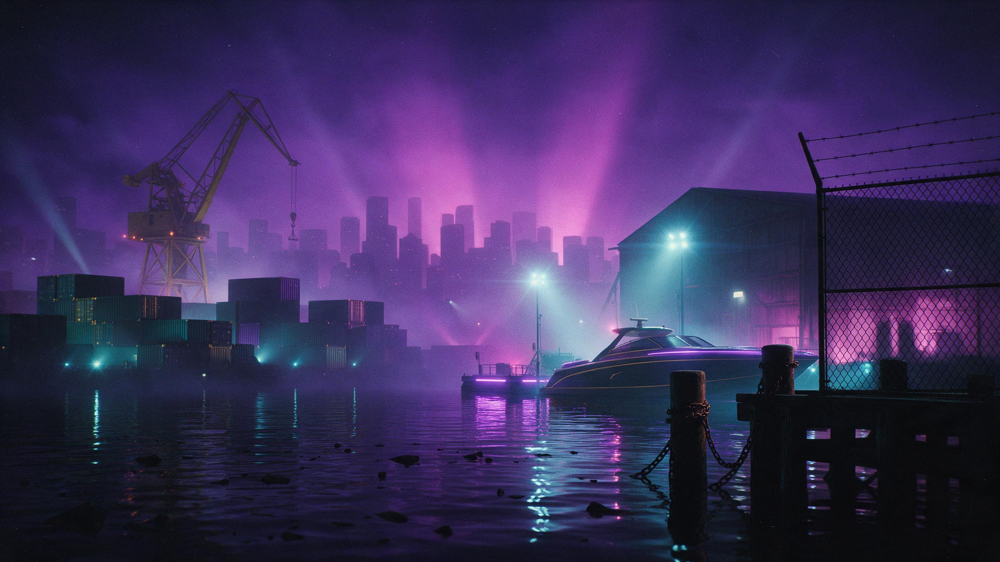
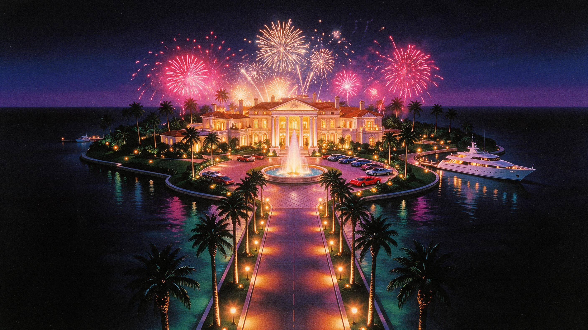

# 🌴 VICE HUSTLE

  

<em>Build a neon-soaked empire while the money is still hot.</em>

  <a href="https://alcadoss.github.io/Vice-Hustle/"><strong>▶ STEP INTO PALMETRO CITY</strong></a>

---

> **WPLM 103.5 — ON AIR…**
>
> *Palmetto City. Summer, 1986. The neon's buzzing, the tar's still soft, and you've got a borrowed Slim Jim, a seedy motel strip, and exactly one talent: getting paid.*
>
> *Here's what nobody tells you about dirty money — it's heavy. Every bill screams your name to the cops. Launder it, and it whispers instead. That's the whole game, hot stuff: run your rackets, feel the HEAT climb, wash the cash before the sirens find it, and take this city one district at a time.*
>
> *The Queens are waiting. The crew's for hire. DJ KRM is watching. Stay tuned.*

---

## THE CITY

| | | |
|---|---|---|
|  |  |  |
| **MOTEL STRIP** — where it begins. Chlorine and bad decisions. | **NEON BEACH** — tourists, tan lines, rackets with sand in the trunk. | **DOWNTOWN** — the skyline. Big money. Bigger heat. |
|  |  |  |
| **THE DOCKS** — freight that moves to a rhythm. | **SWAMP GLADES** — the water is rarely wrong. | **STAR ISLAND** — old money, new problems. |

Every district lives under its own sky — neon rain, thunderstorms that cool the streets, heatwaves that set the whole city washing money. And when you've taken all six… **the decade changes.** Twice.

## WHAT THE CITY OFFERS

🏴 **AN EMPIRE OF DIRTY MONEY** — Thirty rackets from cigarette boot runs to casino cages. Fast cash, loud consequences. The HEAT meter climbs, the sirens come, and everything you didn't launder is gone. The Big Score lets you cash it all out, retire to the Keys, and come back stronger — with Respect in your pocket and a new decade on the horizon: **1986 → Present Day → 2049.**

🎬 **TWELVE HEISTS, THREE WAYS TO PLAY THEM** — Crack the vault dial on timing alone. Outdrive the task force with the cops on your bumper. Track the gold card through a dealer's honest shuffle. Every score opens with painted key art and banks a cinematic in your Vault.

🏁 **THE LIFE** — Drag races on a tach and a prayer. An endless highway full of oncoming traffic, driven in *your* car. Gator races (Noodle is a way of life). Scratch-offs. And Camille's blackjack table downtown — dealer stands on 17, and the champagne is real if you are.

🚗 **A GARAGE OF FIFTEEN** — Win them from races, streaks, casinos, heists and the story itself: from the beat-up Stock Coupé to Roxy's Red Rocket to the 2049 Vector. Pick one and it's *yours* — on the strip, the highway, and every getaway.

👑 **SIX QUEENS, EIGHT LIEUTENANTS** — Solana halves your bribes. Camille boosts the take. Ghost makes raids pointless. Win them over, take them out, deploy them to their home turf — and when they text you at 2AM about last night, answer carefully. Some replies pay.

📻 **A CITY THAT TALKS BACK** — DJ KRM broadcasts your legend live from the tower. His story — five chapters of static, dirty cash and a refusal the whole skyline heard — unspools as you take the city. Weather rolls in, crackdowns sweep the streets, tourist seasons open wallets. The radio plays eighteen stations across three eras, synthesized out of thin air.

## THE BOTTOM LINE

Dirty cash is fast but heavy. Clean money whispers. Respect is forever. **How much can you carry before the city makes you put it down?**

---

  <a href="https://alcadoss.github.io/Vice-Hustle/"><strong>▶ THE NEON'S ON. PLAY IT.</strong></a>

📖 Dug the details? The full field guide lives in the **[wiki](https://github.com/AlcadoSs/Vice-Hustle/wiki)** — every district, heist, car, Queen and tape.

---

*Vice Hustle is a **fan homage** — not affiliated with, endorsed by, or connected to Rockstar Games or Take-Two Interactive. All names, characters, places and art are original. Please don't sue; we're just leaning on a car in front of a motel.*

---

*🔴 ON AIR — "The city isn't for sale. And neither am I."*
