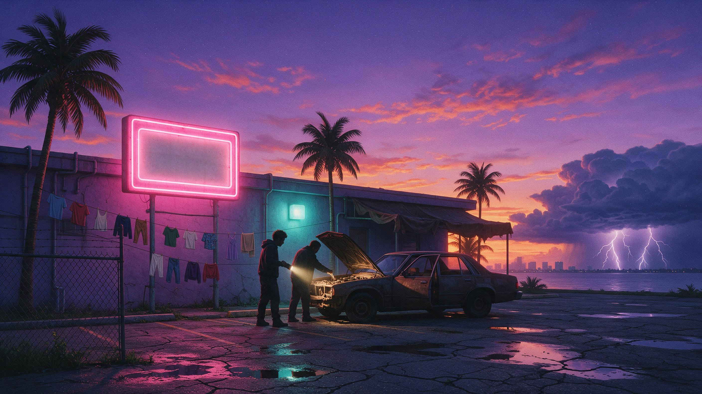
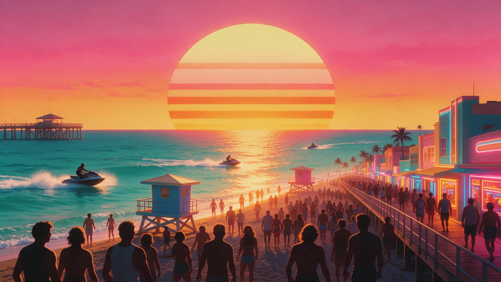
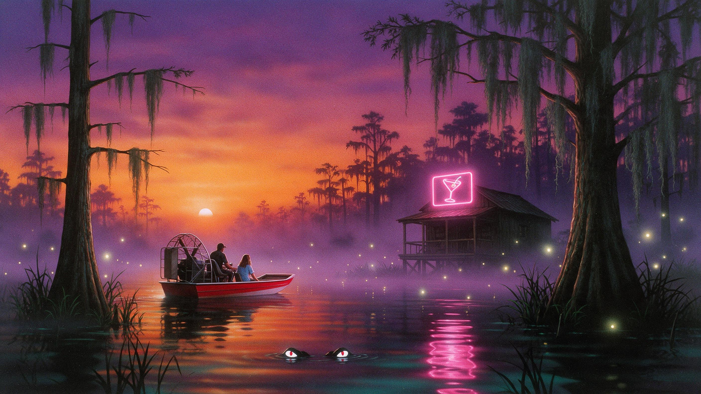

# 🌴 VICE HUSTLE

<p align="center">
  
</p>

<p align="center">
  <em>Build a neon-soaked empire while the money is still hot.</em>
</p>

<p align="center">
  
  
  
  
  
</p>

---

**Vice Hustle** is a fan-made idle/tycoon game — an homage to the GTA VI hype and the 80s Miami-crime genre it resurrects. Start as a nobody with a borrowed Slim Jim on a seedy motel strip, and end up owning Star Island. The twist: **your money is a liability.** Rackets pay fast in *Dirty Cash*, but every dollar raises *Heat*, and Heat brings raids that confiscate everything you didn't launder.

Built as a no-framework, no-build, single-tab web game. All 53 illustrations are AI-generated with **Seedream**, all 20 videos (living district backgrounds, heist cinematics) with **SeedDance**, and the entire soundtrack is **synthesized live in your browser** with the Web Audio API — no audio files, six procedural synthwave radio stations.

## 🕹️ Play

No install, no build:

```
open index.html          # or double-click it — that's the whole game
```

or serve it (recommended, for video autoplay policies):

```
python -m http.server 8123
# → http://localhost:8123
```

## 🎯 The core loop

```
run rackets ──▶ DIRTY CASH ──▶ buy more rackets
                   │                │
                   │           raises HEAT ──▶ RAIDS steal your dirty cash
                   │                │
                   └──▶ LAUNDER (fronts) ──▶ CLEAN MONEY
                                                │
                          districts · crew · upgrades ◀─┘
                                                │
                             THE BIG SCORE (prestige) ──▶ RESPECT ──▶ LEGACY ──▶ ERA II
```

- **Dirty Cash** — fast, spendable, *raidable*. **Clean Money** — laundered, safe, buys the empire.
- **Heat 0–100** with four tiers; at 100 a Task Force taxes your income 25% until you cool off. Bribes, bent lawyers, and leaning on the right people help.
- **The Big Score** — cash the whole empire out, retire to the Keys, come back with permanent Legacy multipliers and eventually change the decade itself.

## ✨ What's inside

| | |
|---|---|
| 🗺️ **6 districts** | Motel Strip → Neon Beach → Downtown → The Docks → Swamp Glades → Star Island, each with 5 rackets and a living AI-animated backdrop |
| 📻 **WPLM Radio** | 6 procedural synthwave stations (one per district), synthesized live with Web Audio — plus sirens, cha-chings and fanfares |
| 🎬 **12 heist scores** | Three minigames — *The Drill*, *The Boost*, *The Con* — with first-clear cinematics watchable in The Vault |
| 👑 **The Queens** | Six companions with painted portraits, unlock conditions and real gameplay perks — take one for a *Night on the Town* |
| 🎲 **Side hustles** | Street races, gator races (bet on Noodle), scratch cards |
| 🧑‍🤝‍🧑 **8 lieutenants** | Auto-hired at milestones, from a bent lawyer to The Ghost |
| ⚖️ **Balance-tested** | Headless simulator (`sim/balance.js`) races playstyles against the live game math — see `docs/BALANCE.md` |
| 📼 **2 eras** | 1986 neon, and *Present Day* (×5 income, full sunny-Florida art reskin) at 100 Respect |

## 🖼️ The city

| Motel Strip | Neon Beach | Downtown |
|---|---|---|
|  |  |  |

| The Docks | Swamp Glades | Star Island |
|---|---|---|
|  |  |  |

*Era II reskins all six in modern daylight — earn it.*

## 🗂️ Project structure

```
index.html · game.css · game.js    the game (no build step)
radio.js                           6 procedural synthwave stations + SFX
sim/balance.js                     24h playstyle balance simulator
docs/GDD.md                        full game design document
docs/ART_BIBLE.md                  style guide + prompt library
docs/BALANCE.md                    balance findings & tuning log
art/                               53 Seedream illustrations
videos/                            20 SeedDance loops & cinematics
saves/endgame.json                 god-mode test save (Settings → Import)
```

## 🎨 Asset pipeline

Every still was generated with **Seedream** using a locked palette and prompt templates from the [art bible](docs/ART_BIBLE.md); every ambient loop and cinematic with **SeedDance**, generated *from* the district stills for palette continuity. District videos fade in only once actually playing, with the painted still always underneath — so the game looks right even where autoplay is blocked.

## ⚠️ Disclaimer

Vice Hustle is a **fan homage** and is **not affiliated with, endorsed by, or connected to Rockstar Games or Take-Two Interactive**. All names, characters, places and art are original. Please don't sue — we're just leaning on a car in front of a motel.

---

*Palmetto City, 1986. The neon's on. The cops are counting.*
